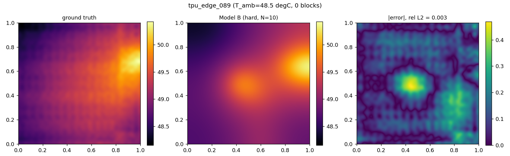
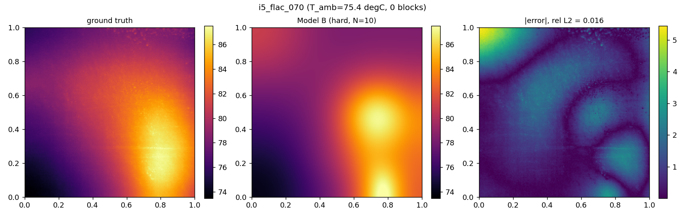
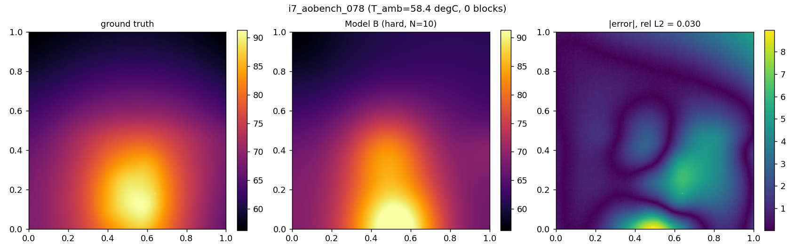

# Model B on real-chip thermal maps (cross-domain validation)

Model B (the per-chip physics-only PINN, `src/train_pinn.py`) trained and
tested so far only on the synthetic HotSpot-style dataset. This note documents
running the same, unmodified pipeline against **real IR-measured thermal maps**
from commercial CPUs/GPU/TPU
([`sheldonucr/commercial_thermal_map_dataset`](https://github.com/sheldonucr/commercial_thermal_map_dataset),
Lu & Tan, MLCAD 2024) -- an out-of-distribution generalisation check, not a
retraining: no network weights or hyperparameters were tuned on this data.

---

## 1. What changed to make this possible

Three real constraints this dataset has, that the synthetic pipeline did not
originally accommodate, and the fix for each:

| Constraint | Fix |
|---|---|
| Native resolution is **non-square** and differs per device (i5: 177x166, i7: 185x154, TPU: 256x244) | Generalised `data_loader.py`'s `grid_coords`/`grid_points`/`field_from_points` and `evaluate.py`'s `sensor_node_mask`/`sensor_rmse` to accept an `(H, W)` tuple, not just a square `n`. No frame is cropped or resized -- every pixel is a real measurement. Backward-compatible: synthetic 128x128 calls are unaffected. |
| No physical die size, floorplan, or power ground truth for these parts | `die_L_x_m = 1.0` (abstract unit square); `block_count = 0`. `t_die`/`h_eff` are chosen so the dimensionless diffusion number `eps = t_die/(h_eff L^2)` matches the synthetic calibration (~5.55e-4) -- what the PDE needs is the *ratio* of lateral conduction to vertical sinking, not absolute metres, which are unknown for these parts. `leak_fraction = 0` (no basis for a per-block leakage split with no floorplan). `evaluate_source()` is skipped gracefully (`source_rel_l2`/`source_centre_err` -> NaN) when no `_Q.npy` ground truth exists. |
| No ambient-temperature sensor | `T_amb` estimated per frame as the 5th percentile (coolest region) |

Sensor positions are chosen the same way as the synthetic dataset: **POD-QR**
(`src/sensors/podqr.py`'s method, Manohar et al. 2018), fit **per device** from
that device's own first 70 frames ("train"), then applied unchanged to the
remaining 30 held-out frames ("test") that are actually scored. Pivot order is
reused directly for N=5/8/10, so sensor sets are nested as in the synthetic
pipeline.

Two files, `GPU_RTX_4060.pkl` and `CPU_R7_4800U.pkl`, were excluded from the
dataset entirely: both show a fixed spatial pattern (legible die-lid text in
the GPU case; a rail/grid structure in the R7 case) that a consecutive-frame
difference test confirmed does **not** change with the die's actual thermal
state -- a fixed-pattern IR-emissivity artefact, not real temperature
structure.

## 2. Pipeline

```
extract_github_frames.py     # pkl -> data/github_real/{train,test}/{matrices,metadata.csv}
generate_github_sensors.py   # per-device POD-QR fit (train) + sensor JSONs (test)
src/train_pinn.py --config experiments/configs/model_b_github.json \
                   --data-root ../data/github_real --sensor-root ../data/generated_github
```

9 devices retained: `i5_{7zip,aobench,flac,opencv,stream}`, `i7_{idle,aobench,
compress7zip}`, `tpu_edge`. 70/30 train/test frames per device (POD-QR fit /
scored, respectively).

## 3. Results (pilot: 27 chips x N{5,8,10} x 3 seeds = 243 solves)

| N | rel L2 (mean +/- seed std) |
|---|---|
| 5  | 0.045 +/- 0.001 |
| 8  | 0.023 +/- 0.002 |
| 10 | 0.018 +/- 0.001 |

Monotonic improvement with N, unlike the synthetic dataset's own Model B
result (0.135 / 0.124 / 0.126 at N=5/8/10), and lower in absolute terms. **This
is not read as "Model B generalises better to real chips."** These IR maps are
single smooth, camera-blurred hotspots per core region, not the synthetic
generator's sharp, possibly-overlapping rectangular sources -- the trainable
Gaussian-blob source model is close to the right functional form for a smooth
blob and a poor one for a sharp rectangle, which is the same "mis-specified
but smooth source wins" finding already in Section 3.1 of
`model_b_implementation_paper.txt`, showing up again here in a different
dataset.

Device-to-device spread dominates over seed spread, same qualitative
conclusion as the synthetic study: best device (`tpu_edge`, 0.003-0.007) is
roughly **20x** better than the worst at N=5 (`i7_aobench`, 0.133).

### Known issues, not papered over

- **`i7_compress7zip` degrades from N=8 to N=10**, consistently across all 3
  held-out frames and all 3 seeds (`final_residual` roughly triples,
  `peak_temp_err` roughly triples to ~11 degC). The two extra sensor readings
  at N=10 are not themselves outliers (checked directly against the raw
  frames: both well inside the normal temperature range) -- this looks like an
  optimisation-landscape effect, where two additional point constraints pull
  the network away from a PDE-consistent solution faster than L-BFGS
  reconciles them, rather than a data problem. **Confirmed by rerunning all 9
  (frame, seed) combinations with the L-BFGS wall-clock cap below**: mean
  `rel_l2` = 0.046, mean `peak_temp_err` = 11.1 degC -- essentially identical
  to the original run, so the degradation is reproducible and is not an
  artefact of one bad solve.
- **`hotspot_loc_cells` (pixel distance to the true peak) is a poor metric on
  this dataset** and should not be read at face value: real IR hotspots are
  broad, camera-blurred plateaus, not sharp peaks, so many pixels sit within a
  fraction of a degree of the true maximum -- the *exact* argmax pixel is
  numerically unstable even when the recovered temperature *value* there is
  accurate (e.g. `i5_flac` N=10: `peak_temp_err` = 0.4 degC but
  `hotspot_loc_cells` = 24.7). **`peak_temp_err` is the metric to trust for
  hotspot accuracy on this dataset; `hotspot_loc_cells` is kept only for
  cross-reference with the synthetic study's sharp-edged sources, where it is
  meaningful.**
- **Training cost is uneven.** Most solves take ~250-300s; a few
  (`i7_aobench`, `i7_compress7zip`, `tpu_edge`) ballooned to 2,300-10,500s on
  a single solve, correlated with poor `final_residual` convergence (L-BFGS
  stalling in its line search). A wall-clock cap on the L-BFGS phase
  (`lbfgs_wall_clock_cap_s`, default 300s, `train_pinn.py`) was added after
  this was found, so no single solve can run away; the best iterate found so
  far is restored regardless of whether the cap is hit. **Verified**: rerunning
  the 9 worst-case `i7_compress7zip` N=10 solves with the cap brought the
  worst solve down from 2,369s to 789s, with `rel_l2`/`peak_temp_err`
  unchanged -- the cap saves wall-clock, it does not (and is not meant to)
  fix the underlying optimisation-landscape issue above.

## 4. Qualitative finding: predicted hotspots are pulled toward the domain centre

Three representative reconstructions (N=10, seed 0):

| | | |
|---|---|---|
|  |  |  |

In **all three** cases -- including `tpu_edge_089`, the single best `rel_l2`
score in the whole pilot (0.003) -- the true hotspot sits at or spills past the
frame's edge, while the predicted field reconstructs it pulled in toward the
domain centre. `rel_l2` barely notices because the broad, cool background
(most of the frame) is matched well; it is not sensitive to a localised miss
in one corner. This is the mechanism behind the `hotspot_loc_cells` numbers in
Section 3, visualised directly.

**Likely cause:** the hard-BC construction (`theta = NN(cos(pi x), cos(pi
y))`) enforces *exactly* adiabatic (`dtheta/dn = 0`) at the frame's edges, by
assumption -- correct for the synthetic dataset, where the generator's domain
genuinely is the whole die with adiabatic sides. These real IR frames are very
likely a **cropped sub-window of a larger die/package**, not the true physical
boundary, so real heat crosses the frame edge in reality. Forced to satisfy
zero flux there while also fitting the interior sensors, the optimiser's best
compromise is a centred blob rather than one that correctly extends to the
edge. This is a **structural mismatch between the hard-BC assumption and this
dataset's field of view**, not a training or sensor-placement issue -- it
would need either a Dirichlet or Robin condition at the frame edge (treating
it as an open boundary, not an adiabatic one) to fix, which is a real
follow-up, not something to attempt today.

## 5. What this validates, and what it doesn't

**Validates:** the pipeline runs end-to-end on real, non-square,
differently-scaled measurement data with no architecture change beyond
generalising two grid-indexing helper functions; the physics-only
reconstruction is stable and accurate on real single-hotspot dies; the
chip-identity-dominates-sensor-count finding replicates outside the synthetic
generator.

**Does not validate:** multi-hotspot or sharp-source recovery on real chips
(no such case exists in this dataset after excluding the two artefact-affected
files); absolute hotspot *localisation* at pixel precision (see
`hotspot_loc_cells` caveat above); correct reconstruction when the true
hotspot sits near the field of view's edge (Section 4 -- a hard-BC/field-of-
view mismatch, not something this pilot's numbers should be read as solving);
source/power recovery (no ground truth exists for real floorplans, so
`source_rel_l2`/`source_centre_err` are NaN throughout).

## 6. Reproduction

```bash
python extract_github_frames.py
python generate_github_sensors.py
cd pure_pinn
python src/train_pinn.py --config experiments/configs/model_b_github.json \
    --data-root ../data/github_real --sensor-root ../data/generated_github \
    --split test --n-chips 27 --sensors 5,8,10 --seeds 0,1,2 \
    --metrics ../results/metrics_github.csv --runs-dir ../results/runs_github
python src/evaluate.py --metrics ../results/metrics_github.csv --plot
```
